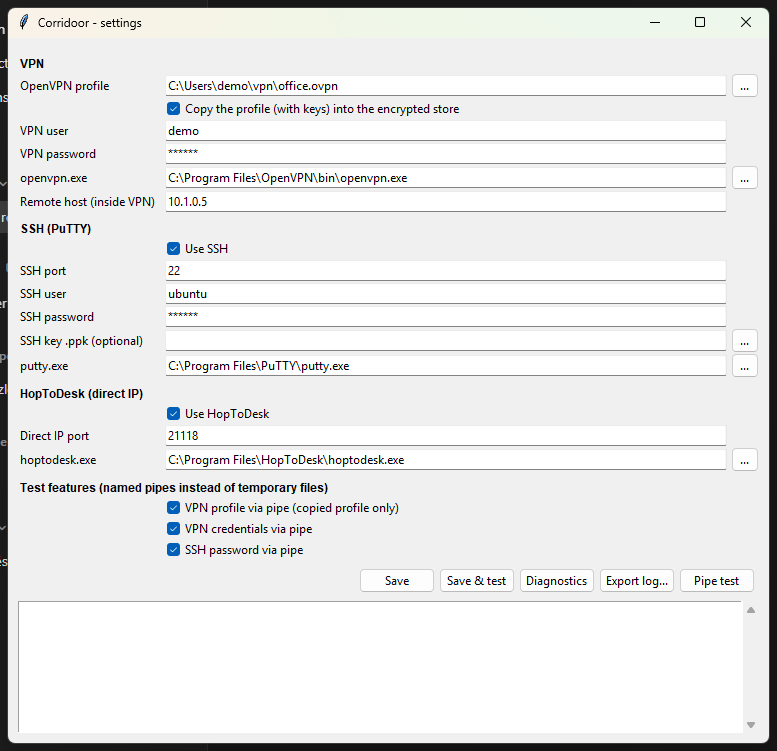

# Corridoor

*One corridor, one door.*

A lightweight Windows launcher that brings up an OpenVPN **split tunnel** to a
single host and then opens an SSH (PuTTY) or HopToDesk session to it. Only the
traffic addressed to that host uses the VPN; everything else keeps its normal route.



> **Status:** VPN split tunnel, SSH, named pipes and HopToDesk have been used
> successfully on Windows. Folder permissions, crash cleanup through the Job
> Object and the build and install scripts have not been verified separately.
> See [tested versions](docs/windows-setup.md#tested-versions).

## Features

- **Single-host split tunnel:** routes pushed by the server are ignored.
- **Two clients:** SSH through PuTTY, or remote desktop through HopToDesk.
- **Settings window** with a step-by-step connection test and full diagnostics.
- **Encrypted storage:** settings, passwords and the profile copy are protected
  with Windows DPAPI in an administrator-only folder.
- **Named pipes (test feature):** secrets reach OpenVPN and PuTTY without temporary files.
- **Clean shutdown:** OpenVPN stops with the session, and a Windows Job Object
  ends it if the launcher crashes.
- **Standard library only** at runtime.

## How it works

1. OpenVPN starts with `--route-nopull` and a `/32` route to the target.
2. The launcher waits for `Initialization Sequence Completed`.
3. It starts PuTTY or HopToDesk against the target address.
4. It stops OpenVPN when the session is over.

## Quick start

You need an OpenVPN server that reaches the remote computer, its `.ovpn` profile,
Windows with OpenVPN Community, PuTTY and/or HopToDesk, and Python 3.10 to 3.14 with
Poetry and the Visual Studio C++ Build Tools for the build.

```powershell
poetry install
poetry run powershell -NoProfile -ExecutionPolicy Bypass -File .\build.ps1
```

Then, in an **elevated** PowerShell window:

```powershell
powershell -ExecutionPolicy Bypass -File .\install.ps1
```

Open **Corridoor Settings**, fill in the profile, VPN login and remote host, select
**Save & test**, then start **Corridoor SSH** or **Corridoor HopToDesk**. Without a
build: `python .\main.py --config` in an elevated window.

## Documentation

| Document | Content |
|---|---|
| [Remote setup](docs/remote-setup.md) | Ubuntu: SSH server, HopToDesk, firewall |
| [Windows setup](docs/windows-setup.md) | downloads, tested versions, build, install, first configuration |
| [Configuration](docs/configuration.md) | every setting, named pipes, tests and diagnostics |
| [Security](docs/security.md) | what is stored where, protections, limitations |
| [Troubleshooting](docs/troubleshooting.md) | symptoms and what to check |
| [Architecture](docs/architecture.md) | modules, data flow, development and tests |

## Development

```powershell
python -m unittest discover -s tests -t .
```

The tests run on any system: Windows APIs and the external programs are replaced
by stand-ins, so they do not replace a test on a real Windows machine.

## License

[MIT](LICENSE). OpenVPN, PuTTY and HopToDesk are separate programs with their own
licenses; they are not included.
