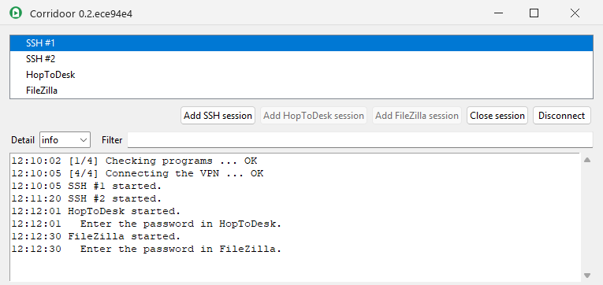

# Corridoor

*One corridor, one door.*

A lightweight Windows launcher that brings up an OpenVPN **split tunnel** to a
single host and then opens SSH (PuTTY) and HopToDesk sessions to it. Only the
traffic addressed to that host uses the VPN; everything else keeps its normal route.
One corridor, one door, as many rooms behind it as you need: several sessions share
the one VPN connection.



> **Status:** VPN split tunnel, SSH, named pipes and HopToDesk have been used
> successfully on Windows. Folder permissions, crash cleanup through the Job
> Object and the build and install scripts have not been verified separately.
> See [tested versions](docs/windows-setup.md#tested-versions).

## Install in 5 minutes

### Checklist: what must be on the computer

- [ ] Windows 10/11, 64-bit, and an administrator account
- [ ] [OpenVPN **Community**](https://openvpn.net/community-downloads/) 2.7 (not OpenVPN Connect)
- [ ] [PuTTY](https://www.chiark.greenend.org.uk/~sgtatham/putty/latest.html) (`putty.exe` and `plink.exe`) and/or [HopToDesk](https://www.hoptodesk.com/download) 1.46.90+
- [ ] [Python](https://www.python.org/downloads/windows/) 3.10 to 3.14, 64-bit, with **Add to PATH** and **tcl/tk**
- [ ] [Poetry](https://python-poetry.org/docs/#installation) 2.2+
- [ ] [Visual Studio Build Tools](https://visualstudio.microsoft.com/visual-cpp-build-tools/) with **Desktop development with C++**
- [ ] The `.ovpn` profile (and VPN user/password if it asks) and the remote computer's internal IP
- [ ] The remote computer is ready: [remote setup](docs/remote-setup.md)

### Install

In a **regular** PowerShell window in the repository folder:

```powershell
poetry install
poetry run powershell -NoProfile -ExecutionPolicy Bypass -File .\build.ps1
```

Then, in an **elevated** PowerShell window in the same folder:

```powershell
powershell -ExecutionPolicy Bypass -File .\install.ps1
```

Then open **Corridoor Settings** (desktop shortcut), fill in the profile, VPN login
and remote host, select **Save & test**, and start **Corridoor SSH** or
**Corridoor HopToDesk**. Details: [Windows setup](docs/windows-setup.md).

## Features

- **Single-host split tunnel:** routes pushed by the server are ignored.
- **Several sessions on one VPN:** add any number of SSH (PuTTY) windows and one
  HopToDesk session to the list, and close each on its own. Disconnecting closes all.
- **Settings window** with a step-by-step connection test and full diagnostics.
- **Encrypted storage:** settings, passwords and the profile copy are protected
  with Windows DPAPI in an administrator-only folder.
- **Named pipes (test feature):** secrets reach OpenVPN and PuTTY without temporary files.
- **Clean shutdown:** closing the main window stops every session and the VPN, and
  a Windows Job Object ends OpenVPN and all PuTTY windows if the launcher crashes.
- **Standard library only** at runtime.

## How it works

1. OpenVPN starts with `--route-nopull` and a `/32` route to the target.
2. The launcher waits for `Initialization Sequence Completed`.
3. It opens the first session (PuTTY or HopToDesk) against the target address;
   more can be added from the list.
4. It stops all sessions and OpenVPN when you disconnect.

## Documentation

| Document | Content |
|---|---|
| [Remote setup](docs/remote-setup.md) | Ubuntu: SSH server, HopToDesk, firewall |
| [Windows setup](docs/windows-setup.md) | downloads, tested versions, build, install, first configuration |
| [Configuration](docs/configuration.md) | every setting, named pipes, tests and diagnostics |
| [Security](docs/security.md) | what is stored where, protections, limitations |
| [Troubleshooting](docs/troubleshooting.md) | symptoms and what to check |
| [Architecture](docs/architecture.md) | modules, data flow, development and tests |

## Development

```powershell
python -m unittest discover -s tests -t .
githooks\install.ps1
```

The second command (once per clone) enables the git hook that keeps the version
current. The version is `0.2.<commit id>`: the base `0.2` is the first line of the
`VERSION` file and changes only on request, the commit id is written by the
post-commit hook (and by `build.ps1`) into the untracked file
`corridoor/_version.py`. It is shown in every window title, in the first log line
and by `corridoor.exe --version`.

The tests run on any system: Windows APIs and the external programs are replaced
by stand-ins, so they do not replace a test on a real Windows machine.

## License

[MIT](LICENSE). OpenVPN, PuTTY and HopToDesk are separate programs with their own
licenses; they are not included.
