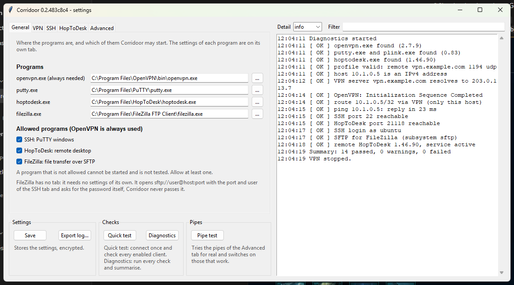
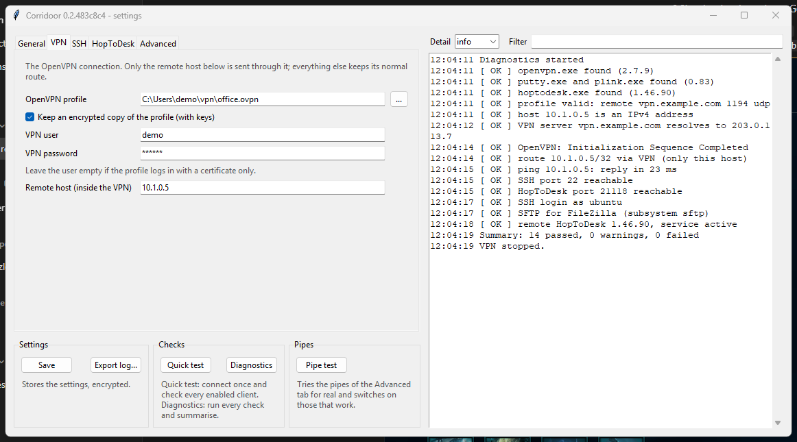
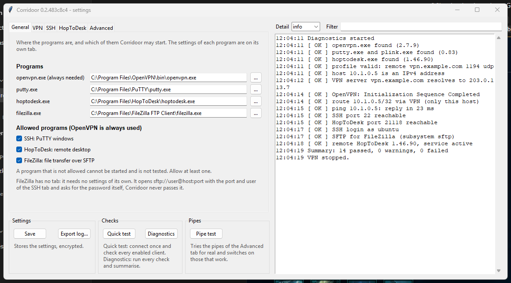

# The settings window

The window has three parts, top to bottom:

1. **Tabs** with the settings: General, VPN, SSH, HopToDesk, FileZilla, Advanced.
2. **Three boxes with actions**, each with one job (see [below](#settings-checks-pipes-what-is-what)).
3. The **log** of whatever is running.

## Tab: General

Where the programs are, and which of them Corridoor may start. The settings of each
program are on its own tab.

| Setting | Description |
|---|---|
| openvpn.exe | path of OpenVPN Community (always needed) |
| putty.exe | path of PuTTY; `plink.exe` must be in the same folder |
| hoptodesk.exe | path of HopToDesk |
| filezilla.exe | path of FileZilla (usually `C:\Program Files\FileZilla FTP Client\filezilla.exe`) |
| Allowed programs | **SSH** (PuTTY windows), **HopToDesk**, **FileZilla**. A program that is not allowed cannot be started and is not tested. Allow at least one. |

You only need the paths of the programs you allow.

## Tab: VPN

| Setting | Description |
|---|---|
| OpenVPN profile | path of the `.ovpn` file |
| Keep an encrypted copy | stores the profile, with certificates and keys embedded, in the encrypted store (default: on). Save again after changing the original. |
| VPN user / password | leave the user empty for certificate-only authentication |
| Remote host | IPv4 address of the target inside the VPN. A host name must resolve **without** the VPN. |

## Tab: SSH (PuTTY)

| Setting | Description |
|---|---|
| SSH port / user / password | login data; the password may stay empty when a key is used |
| SSH key `.ppk` | optional private key. Only its path is stored. |

With a passphrase-protected key, the non-interactive login test fails.

## Tab: HopToDesk

| Setting | Description |
|---|---|
| Direct IP port | default `21118` |

On the remote machine, enable **Settings > Network > Direct IP access** and allow the
port in its firewall. The password is entered in HopToDesk. Passing an IP address to
`--connect` should be verified with your HopToDesk version.

## Tab: FileZilla

File transfer over SFTP. There is nothing to set on this tab: the session opens
`sftp://user@host:port` with the **user and port of the SSH tab**, so SSH password
login or a key must work on the remote machine. **SSH** does not have to be allowed
on the General tab, only **FileZilla**. FileZilla is started with `-l interactive`: it
asks for the password itself, so Corridoor never gives it one and it never appears on
a command line. If you use a key, add it in FileZilla (**Settings > SFTP**). Opening
an sftp address from the command line should be verified with your FileZilla version.

Like HopToDesk, FileZilla usually hands the request over to a running instance, so
**Close session** only removes it from the list; close the FileZilla window yourself.

## Tab: Advanced

| Setting | Description |
|---|---|
| VPN profile via pipe | hand the decrypted profile to OpenVPN through a pipe (only with a copied profile) |
| VPN credentials via pipe | the same for the VPN user name and password |
| SSH password via pipe | the same for the password read by PuTTY and plink |
| Log detail | `info` (default) or `debug` |

You normally do not tick the pipe boxes by hand; the **Pipe test** does it.

### Logging

`info` shows the steps, results, warnings and the OpenVPN output. `debug` shows nearly
everything and marks it `[debug]`: the settings (passwords shown as `***`), Python and
Windows versions, every command line that is started (OpenVPN, PuTTY, plink,
HopToDesk, FileZilla), process ids, job object and mutex events, pipe connections,
ping output, routing lookups, the SSH banner, the answer of the remote HopToDesk
probe, the commands to the session list, and the cleanup. Secrets are logged only as a
length and the path of their file or pipe, never as text.

The level applies as soon as you select **Save**, also to a session that is already
running. The file `corridoor.log` gets the same detail. Switch back to `info` when
the problem is solved: the debug log is long, and it contains paths, addresses and
user names (see [Security](security.md)).

## Settings, checks, pipes: what is what

These three are easy to mix up. They answer different questions:

| Box | Question | Changes your settings? |
|---|---|---|
| **Settings** (Save, Export log) | "Remember what I typed." | yes: stores them, encrypted |
| **Checks** (Quick test, Diagnostics) | "Do my settings work?" | no |
| **Pipes** (Pipe test) | "Which way of handing secrets to programs works on this computer?" | yes: switches on the pipes that work |

### What is a pipe?

OpenVPN and PuTTY need the VPN profile and the passwords as a *file*. By default
Corridoor writes a short-lived temporary file into its protected folder and deletes it
afterwards. A **named pipe** looks like a file to the program, but the data is handed
over from memory, so nothing is written to disk. Not every version of OpenVPN or
PuTTY accepts a pipe in place of a file; that is why it is optional.

### What is a test?

A test does not change how secrets are handled. It connects (or probes) and reports:

- **Quick test**: saves, then connects the VPN once and checks every enabled client:
  programs, profile, name resolution, VPN server, VPN connection, ping, SSH and
  HopToDesk ports, SSH login. Stops at the first failure.
- **Diagnostics**: runs *all* checks even after a failure (only the dependent ones
  are skipped), includes the route change, and prints a summary. If SSH is enabled
  with a user name it also logs in and inspects HopToDesk on the remote Linux machine
  (installed version, service, processes; nothing is changed). It fails if HopToDesk
  is missing or not running, and warns if it is older than 1.46.90.

A missing ping reply is only a warning, because ICMP is often blocked. A UDP VPN port
cannot be probed in advance; the handshake is the actual test. The HopToDesk and
FileZilla checks cover port reachability, not authentication.

### What is the Pipe test?

The one test that *does* change settings: it tries the pipes with real connections
and keeps what works.

1. The VPN is connected for real, with pipes for profile and credentials. If that
   fails, the test falls back step by step to temporary files.
2. Through the working tunnel, plink logs in with the password from a pipe. The key
   file is left out so that the password is actually used. This step needs SSH
   enabled, a user name, a password and an already accepted host key.
3. Exactly the pipes that worked are switched on and saved. Untested ones stay off.

A rejected VPN login stops the test immediately to avoid locking the account. A
cancelled or aborted test changes nothing. There is no automatic fallback later: run
the test again after updating OpenVPN or PuTTY. HopToDesk and FileZilla receive no
secrets from the launcher.
