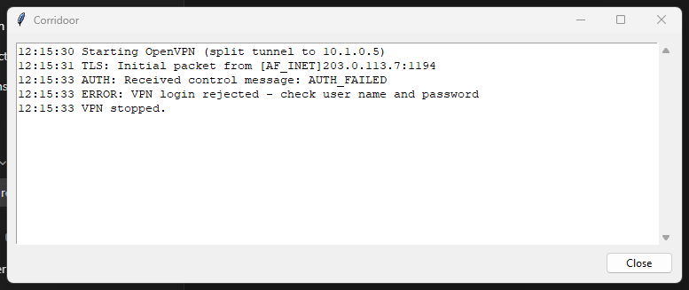

# Troubleshooting

Start with **Diagnostics** in the settings window; the log names the failing check.
The file `C:\Program Files\Corridoor\corridoor.log` keeps the history.

| Symptom | What to check |
|---|---|
| `file not found` | paths in the settings window |
| `AUTH_FAILED` | VPN user name and password |
| HopToDesk keeps reconnecting | HopToDesk version on both computers (1.46.90 or newer) |
| `getaddrinfo failed` for an IP address | no leading zeros: `10.1.0.5`, not `10.01.0.5` |
| `cannot stat file '\\.\pipe\...'` | warning only; it did not prevent the connection in testing |
| `TLS key negotiation failed` | server address, port, firewall, `tls-auth` / `tls-crypt` key |
| SSH port not reachable | SSH service, firewall, VPN routing |
| HopToDesk port not reachable | Direct IP access and firewall on the remote machine |
| `another session is already running` | close the other session |
| host key error in the SSH login test | start **Corridoor SSH** once and accept the key after comparing the fingerprint |

