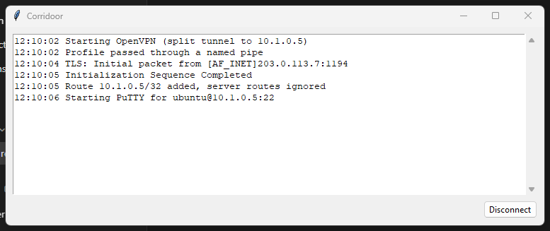

# Local computer setup (Windows)

## Downloads

| Software | Download | Needed for |
|---|---|---|
| OpenVPN **Community** 2.7 | [openvpn.net/community-downloads](https://openvpn.net/community-downloads/) | always; provides `openvpn.exe`. OpenVPN Connect is not supported. |
| PuTTY 0.77 or newer | [PuTTY latest release](https://www.chiark.greenend.org.uk/~sgtatham/putty/latest.html) | SSH mode; `putty.exe` and `plink.exe` in the same folder |
| HopToDesk **1.46.90** or newer | [HopToDesk64.exe](https://dl.hoptodesk.com/HopToDesk64.exe), [all downloads](https://www.hoptodesk.com/download) | HopToDesk mode |
| Python **3.10 to 3.14**, 64-bit | [python.org for Windows](https://www.python.org/downloads/windows/) | build, or running from source |
| Visual Studio Build Tools | [C++ build tools](https://visualstudio.microsoft.com/visual-cpp-build-tools/) | build; select **Desktop development with C++** |
| Poetry 2.2 or newer | [installation guide](https://python-poetry.org/docs/#installation) | build; installs Nuitka from `pyproject.toml` |

Nuitka needs a C compiler. Its automatically downloaded MinGW64 does not support
Python 3.13 or newer, so install the Build Tools for those versions.

## Tested versions

| Component | Version | Result |
|---|---|---|
| Windows | build 10.0.26300, 64-bit | works |
| OpenVPN Community | 2.7.9 | works, including profile and credentials through named pipes |
| PuTTY | 0.83 | SSH works; the password pipe was tested with `plink` |
| HopToDesk | 1.46.90 | works |
| HopToDesk | 1.44.4 | **does not work:** the session keeps reconnecting |

The remote computer in the HopToDesk test ran Ubuntu Linux.

## 1. Install the software

1. Install OpenVPN Community, PuTTY and HopToDesk from the links above.
2. Install Python with **Add python.exe to PATH** and **tcl/tk** selected.
3. Install the Build Tools with **Desktop development with C++**.
4. Install Poetry.
5. Check in a new PowerShell window: `python --version` and `poetry --version`

## 2. Build and install Corridoor

Clone the repository (or extract the source archive into an empty folder). In a
**regular** PowerShell window in that folder:

```powershell
poetry install
poetry run powershell -NoProfile -ExecutionPolicy Bypass -File .\build.ps1
```

Immediately afterwards, in an **elevated** PowerShell window in the same folder:

```powershell
powershell -ExecutionPolicy Bypass -File .\install.ps1
```

The program is installed to `C:\Program Files\Corridoor_app\`. Shortcuts are placed
on the desktop and in the Start menu for all users.

| Shortcut | Command | Purpose |
|---|---|---|
| Corridoor SSH | `corridoor.exe` | connect with PuTTY |
| Corridoor HopToDesk | `corridoor.exe --hoptodesk` | connect with HopToDesk |
| Corridoor Settings | `corridoor.exe --config` | configure, test, diagnose |

If no settings have been saved yet, every shortcut opens the settings window.

Without building, run it from an elevated PowerShell window:
`python .\main.py --config`

**Updating:** close Corridoor, update the sources, and repeat the build and install
steps. Saved settings are kept (they live in a different folder).

## 3. First configuration

1. Open **Corridoor Settings**.
2. **VPN:** select the `.ovpn` profile, keep **Copy the profile** on, enter the VPN
   user and password, check the `openvpn.exe` path.
3. **Remote host:** the internal IP only, without user name, port or leading zeros.
4. **SSH:** enable it, enter port, user and password (or key), check `putty.exe`.
5. **HopToDesk:** enable it, keep port `21118`, check the `hoptodesk.exe` path
   (`Program Files` or `Program Files (x86)`).
6. Select **Save & test**. The first SSH login may fail because the host key is unknown:
   close the settings, start **Corridoor SSH**, compare the fingerprint with the one
   noted on the remote computer, and accept it only if they match.
7. Run **Pipe test**, then **Diagnostics**.

## Daily use

Start **Corridoor SSH** or **Corridoor HopToDesk**. To disconnect, close PuTTY or
select **Disconnect**. In HopToDesk mode, only **Disconnect** closes the VPN; closing
the HopToDesk window does not.


